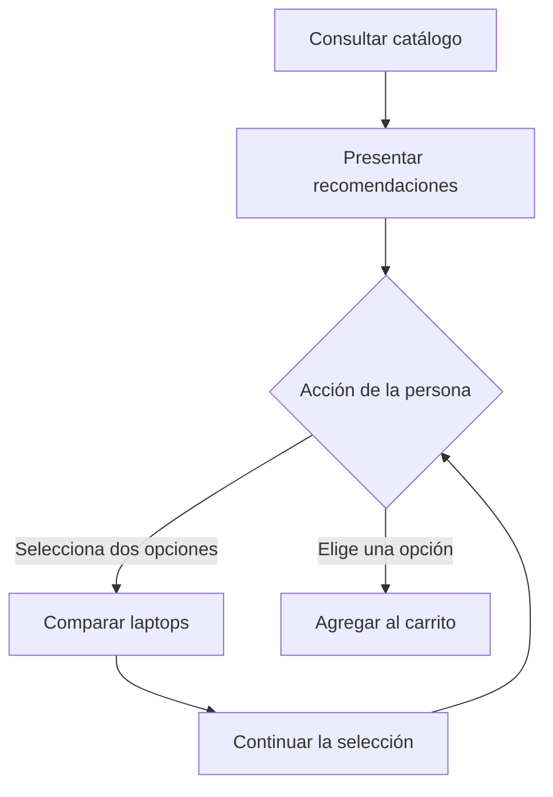

# Flujo

Un flujo especifica cómo responde el sistema ante una acción o situación
para conseguir un resultado. El flujo describe comportamiento; las tareas
describen el trabajo necesario para implementarlo.

Aplica las fases y las reglas comunes de la skill `metodologia`. Consulta
su `SKILL.md` si todavía no lo has leído en esta sesión.

## Contexto y destino

Guarda cada flujo en `workspace/flujos/<Nombre del flujo>.md`, desde la raíz
del proyecto. Usa un nombre único en el workspace.

Lee el área correspondiente, las decisiones aplicables y los flujos
relacionados. Si modificas un flujo, lee también las tareas afectadas. Consulta
el código pertinente cuando necesites verificar el comportamiento existente.

Para cambiar un flujo vigente, aplica el ciclo de cambio y análisis de
impacto de `metodologia`. Conserva la versión integrada en la rama principal
y prepara la propuesta en una rama de trabajo.

Para crear un flujo, lee [assets/flujo.md](assets/flujo.md) y completa la
plantilla directamente en el archivo de destino. Las plantillas permanecen
en las skills; el workspace contiene los artefactos del proyecto.

## Definir el comportamiento

1. Aclara quién necesita el comportamiento, qué problema resuelve y qué
   resultado espera. Delimita qué incluye.
2. Identifica qué lo activa y las condiciones necesarias para comenzar.
3. Describe el recorrido principal, las alternativas y los errores relevantes
   mediante Mermaid. Añade las reglas que el diagrama no expresa con precisión.
4. Define resultados observables que permitan comprobar cada salida relevante.
5. Identifica las elecciones pendientes y registra las decisiones necesarias
   según las reglas comunes. Enlázalas en `decisiones:`. No presentes una
   elección pendiente como un comportamiento ya resuelto.

Completa las secciones con información del proyecto. Sustituye las
indicaciones de la plantilla; no dejes texto de ejemplo como especificación.
Si falta información necesaria, aclárala con el usuario. Conserva el flujo
`en-diseño` mientras su comportamiento no esté definido.

## Límites del flujo

Utiliza un único artefacto llamado flujo. Una pantalla, un mensaje o una
consulta técnica pueden ser pasos del mismo comportamiento.

Considera separar una parte cuando tenga inicio y resultado propios, necesite
especificarse o comprobarse por separado, o se utilice desde varios recorridos.
Estos criterios orientan la separación; no es necesario cumplirlos todos.

La longitud indica que conviene revisar la estructura, pero no determina
por sí sola una división. Mantén juntos los pasos que forman un comportamiento
coherente. Un diagrama grande puede acompañarse de detalles dentro del mismo flujo.

No crees una categoría de artefacto llamada subflujo.

## Secciones y subsecciones

Completa [assets/flujo.md](assets/flujo.md) con estas secciones, en este orden:

| Sección | Contenido |
|---|---|
| Propósito y alcance | Quién necesita el comportamiento, resultado buscado y límites |
| Inicio y condiciones previas | Activador y condiciones necesarias antes de comenzar |
| Comportamiento | Diagrama Mermaid y detalles del recorrido principal, alternativas y errores |
| Reglas | Condiciones y restricciones que precisan el comportamiento |
| Conexiones con otros flujos | Paso, condición, destino y continuación de cada conexión |
| Resultados comprobables | Salidas observables y condiciones para considerarlas correctas |
| Tareas | Vista automática `![[flujo-tareas.base]]` |

La información que el propio flujo obtiene durante su recorrido no es una
condición previa. El diagrama muestra la secuencia; las reglas precisan sus
condiciones. Los resultados permiten verificar el comportamiento completo.

Usa `##` para las secciones y `###` para subsecciones cuando agrupen
información que necesite explicarse por separado. Elige títulos específicos,
como Información insuficiente o Requisitos de selección. No impongas
subsecciones fijas ni rellenes apartados con texto vacío.

Omite Conexiones con otros flujos cuando no existan conexiones. Sustituye
las indicaciones de la plantilla por información del proyecto. No añadas
historial ni repitas el contenido de las decisiones.

## Relaciones del flujo

Aplica el modelo común de relaciones de la skill `metodologia`.

Declara `area:` y `decisiones:` únicamente en las propiedades.
Declara en `codigo:` los puntos de entrada mínimos de la implementación.
Mantén la lista vacía si todavía no existe. Actualízala al validar el cambio
y cuando un refactor mueva esos puntos. Las tareas heredan este contexto
y añaden solo lo necesario para su cambio. No añadas
listas de flujos hijos ni de tareas en el cuerpo. Las tareas declaran
`flujo:` y la sección Tareas las muestra mediante una vista.

Escribe los wikilinks a otros flujos en Conexiones con otros flujos.
Identifica en el diagrama el paso correspondiente, usando el mismo nombre,
sin repetir el wikilink en propiedades o en otras secciones.

Cada conexión explica qué la activa, qué flujo se inicia, qué resultado
necesita el origen y cómo continúa el recorrido. Consulta el destino antes
de enlazarlo y evita copiar sus reglas. Un regreso se describe en la conexión
y en el diagrama; no exige un enlace inverso en la nota de destino.

Ejemplo: el flujo Recomendar laptops presenta opciones y permite comparar
dos antes de elegir. Comparar laptops tiene inicio y resultado propios.
Consultar el catálogo sigue siendo un paso interno de la recomendación.



En Conexiones con otros flujos, escribe:

```markdown
- Comparar opciones: al seleccionar dos laptops, inicia
  [[Comparar laptops]]. Al terminar, continúa la selección.
- Agregar una opción: al elegir una laptop, inicia [[Agregar al carrito]].
```

Estos nombres son ejemplos. Cada enlace del proyecto debe resolver a un
flujo existente. Si falta definir el destino, aclara su comportamiento antes
de presentar la conexión como resuelta.

## Revisar antes de preparar tareas

Comprueba que:

- El propósito, el inicio, las condiciones y las salidas están definidos.
- El diagrama y las reglas describen el mismo comportamiento.
- Las alternativas relevantes tienen resultados comprobables.
- Las decisiones pendientes están identificadas y las firmes se respetan.
- Los enlaces resuelven a artefactos existentes y las conexiones son claras.
- No se duplica otro flujo ni se mezcla comportamiento con instrucciones de código.

Aplica el protocolo común de verificación. En diseño, no escribas código.
La preparación de tareas continúa según la skill `metodologia`.
