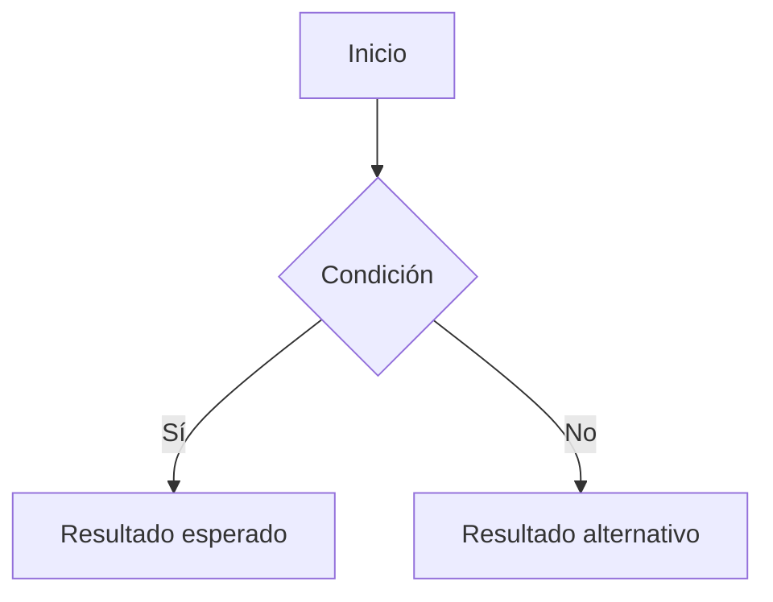

# Nombre del flujo

## Propósito y alcance

Quién necesita el comportamiento, qué resultado busca y qué incluye.

## Inicio y condiciones previas

Qué acción o situación activa el flujo y qué debe cumplirse para comenzar.

## Comportamiento

Detalles necesarios para entender el recorrido y sus alternativas.

## Reglas

Condiciones y restricciones que precisan el comportamiento.

## Conexiones con otros flujos

- Paso de conexión: condición que lo activa, [[Flujo de destino]],
  resultado que necesita el origen y continuación o regreso, si corresponde.

## Resultados comprobables

- Resultado observable del recorrido principal y condiciones de cumplimiento.
- Resultados observables de las alternativas y errores relevantes.

## Tareas

![[flujo-tareas.base]]
