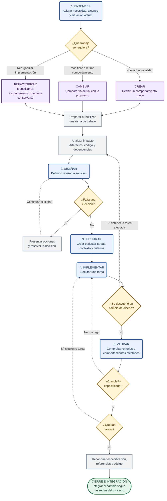

# Metodología de trabajo

La especificación vive en `workspace/`. El código debe cumplirla.
Trabaja con Obsidian y Git. Mantén la especificación aplicable y el trabajo
pendiente en el vault; Git conserva la historia.

Esta skill define el proceso común. Para crear, revisar o modificar un
flujo, utiliza [flujo](../flujo/SKILL.md), que contiene su procedimiento
y plantilla.

## Artefactos

| Artefacto | Función | Destino |
|---|---|---|
| Área | Organizar un dominio del producto | `workspace/areas/` |
| Flujo | Especificar un comportamiento y sus resultados | `workspace/flujos/` |
| Decisión | Registrar una elección que condiciona la solución y su motivo | `workspace/decisiones/` |
| Tarea | Definir un cambio concreto y sus criterios de aceptación | `workspace/tareas/` |

El flujo describe comportamiento; la tarea describe trabajo.
El Panel y las vistas de Obsidian permiten consultar los artefactos.

Antes de escribir relaciones entre artefactos, consulta
[references/relaciones.md](references/relaciones.md).
Antes de asignar o cambiar estados, consulta
[references/estados.md](references/estados.md).

## Fases

| Fase | Acción | Resultado |
|---|---|---|
| Entender | Aclarar necesidad, alcance y comportamiento actual | Problema y resultado esperado claros |
| Diseñar | Definir comportamiento y resolver elecciones | Especificación comprobable |
| Preparar | Revisar impacto, dependencias y tareas | Trabajo concreto y contexto suficiente |
| Implementar | Ejecutar las tareas según la especificación | Código que implementa lo acordado |
| Validar | Comprobar resultados y reconciliar código y artefactos | Cambio verificado y preparado para integrar |

Una fase es una actividad, no un documento. Vuelve a la fase necesaria
cuando descubras información que cambie la solución.

## Recorrido de trabajo

Crear, cambiar y refactorizar son tipos de trabajo identificados en Entender.
Los tres utilizan las mismas fases. La propuesta se desarrolla en una rama;
la versión integrada permanece separada hasta el cierre.

La rama agrupa un cambio revisable y validable. Puede contener una tarea
o varias; sus reglas de creación y nombres están en
[references/cambios.md](references/cambios.md).

> [!info] Leyenda del diagrama
> - Azul: fases de trabajo.
> - Morado: tipos de trabajo.
> - Gris: acciones del proceso.
> - Amarillo: preguntas que controlan el avance.
> - Verde: cierre e integración.
>
> Flechas continuas: avance. Flechas discontinuas: repetición o regreso.

Crear y cambiar recorren las mismas fases. En un refactor, el diseño revisa
la organización técnica y conserva las entradas, salidas y reglas del
comportamiento existente. Si requiere cambiar ese comportamiento, trátalo
como un cambio funcional y revisa su impacto.

Para modificar decisiones, flujos, tareas o una implementación existente,
consulta [references/cambios.md](references/cambios.md).

## Aplicar las fases

1. Entender: identifica el resultado solicitado. Si hay software existente,
   revisa lo que hace hoy. Distingue diseño, implementación y revisión.
2. Diseñar: utiliza la skill del artefacto correspondiente. Define resultados
   comprobables y resuelve las decisiones pendientes antes de implementar.
3. Preparar: crea o ajusta tareas, criterios, dependencias y contexto. Comprueba
   que cada tarea contribuye al flujo y que no contradice decisiones firmes.
4. Implementar: ejecuta el trabajo autorizado. Detén la tarea afectada si
   aparece una elección pendiente y vuelve al diseño.
5. Validar: comprueba los criterios de las tareas y el comportamiento del flujo.
   Actualiza los artefactos y referencias que el cambio afectó.

Para cambios pequeños sin elecciones pendientes, aplica las fases de forma
breve y prepara una tarea directamente. El tamaño del cambio no elimina
la comprobación del resultado.

## Decisiones pendientes

No implementes una tarea con decisiones aplicables abiertas.

Cuando aparezca una elección que corresponda al usuario, registra una decisión
abierta con opciones y recomendación. Enlázala desde el flujo y marca la tarea
afectada como bloqueada. Explica qué necesita resolverse. Continúa con trabajo
independiente cuando sea posible.

## Contexto y referencias al código

Para trabajar una tarea, lee su nota, su flujo, las decisiones aplicables,
los puntos de entrada de código del flujo y el contexto adicional de la tarea.
Sigue las dependencias relevantes que descubras; las referencias son un punto
de partida, no una lista exhaustiva de archivos afectados.

El flujo declara en `codigo:` referencias mínimas a su implementación.
La tarea declara en `codigo:` solo el contexto adicional necesario para
su cambio. No copies la lista del flujo a cada tarea.

Guarda rutas relativas a la raíz del proyecto. No inventes archivos existentes:
si el flujo todavía no está implementado, puede mantener `codigo: []`.
Las tareas pueden identificar archivos que necesitan crearse.

Antes de cerrar el cambio, comprueba las referencias. Si un refactor mueve
un punto de entrada, actualiza el flujo en el mismo cambio.

## Verificación y cierre

Antes de implementar, revisa enlaces, estados, decisiones pendientes,
contradicciones y trabajo concurrente sobre la implementación afectada.
Considera tanto el código heredado del flujo como el contexto de las tareas;
comparar únicamente sus propiedades `codigo:` no detecta todos los solapamientos.

Después de implementar, verifica criterios de aceptación y comportamientos
afectados. No declares el resultado validado si no pudiste comprobarlo:
indica qué comprobación falta.

Presenta hallazgos breves con su impacto y la acción necesaria. Corrige fallos
de implementación antes de cerrar. Si el problema requiere cambiar el diseño,
vuelve a analizar el impacto y resolver las elecciones necesarias.

Integra especificación y código correspondientes en el mismo cambio, según
las autorizaciones y reglas del proyecto. Actualiza enlaces y puntos de entrada.
Retira información sustituida cuando el reemplazo esté validado e integrado;
no borres información necesaria para interpretar trabajo todavía pendiente.

## Escritura

- Usa Markdown sencillo, nombres únicos y términos consistentes.
- Escribe instrucciones y comportamiento concretos, sin adornos ni relleno.
- Evita repetir propiedades, reglas de otros artefactos o listas derivables.
- Reescribe el contenido vigente; Git conserva las versiones anteriores.
- Mantén la concisión sin omitir condiciones necesarias. Divide los flujos
  según los criterios de la skill `flujo`, no por un límite de líneas.

## Entorno y plantillas

`workspace/` es el vault de Obsidian del proyecto. Utiliza
`obsidian-markdown` para los artefactos, `obsidian-bases` para las vistas
y `obsidian-cli` para operaciones que requieran la aplicación.

Las plantillas permanecen en las skills. Complétalas y guarda los artefactos
directamente en su carpeta del workspace.

Si el proyecto todavía no tiene ese espacio, consulta
[references/preparar-proyecto.md](references/preparar-proyecto.md).
