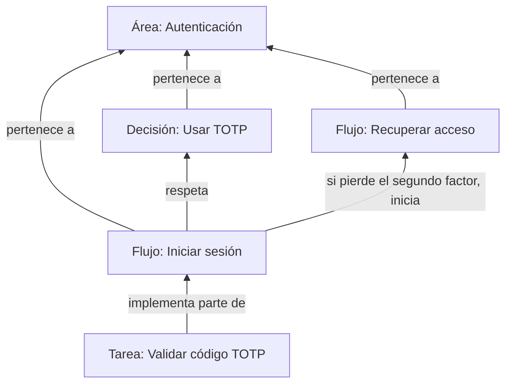

# Relaciones entre artefactos

Cada relación se declara una sola vez. Las vistas y los enlaces entrantes
permiten consultarla desde el otro extremo.

| Relación | Significado | Dónde se declara |
|---|---|---|
| Flujo a área | El comportamiento pertenece a ese dominio | Propiedad `area:` del flujo |
| Decisión a área | La elección corresponde a ese dominio | Propiedad `area:` de la decisión |
| Flujo a decisión | El comportamiento respeta esa elección | Propiedad `decisiones:` del flujo |
| Tarea a flujo | El trabajo implementa parte del comportamiento | Propiedad `flujo:` de la tarea |
| Flujo a otro flujo | El recorrido utiliza o continúa otro comportamiento | Sección Conexiones con otros flujos del origen |

El diagrama muestra relaciones escritas, no el orden de ejecución. Los
nombres son ejemplos; los enlaces del proyecto deben resolver a sus
artefactos reales.

Escribe los wikilinks de las propiedades entre comillas y utiliza nombres
únicos en el vault. La tarea obtiene el área y las decisiones desde su flujo;
no copia esas propiedades. Si aparece una nueva decisión durante una tarea,
enlázala desde el flujo antes de continuar.

La decisión no mantiene una lista `afecta:` de flujos o tareas. Consulta
sus enlaces entrantes para conocer qué comportamientos la utilizan.

El área muestra sus flujos mediante `![[area-flujos.base]]`. El flujo
muestra sus tareas mediante `![[flujo-tareas.base]]`. No escribas listas
manuales ni enlaces de vuelta para repetir estas relaciones.

La lista de áreas del Panel es el punto de entrada del vault. No listes
flujos en el Panel.

Las conexiones entre flujos se detallan según la skill `flujo`. Describir
un regreso en el comportamiento no exige un enlace inverso entre notas.

## Referencias de implementación

El flujo declara puntos de entrada mínimos en `codigo:`. La tarea consulta
esos puntos a través de su flujo y declara solo contexto adicional en
`codigo:`. Usa rutas relativas al proyecto. No copies la misma lista.
Las referencias no crean un inventario completo de dependencias.
